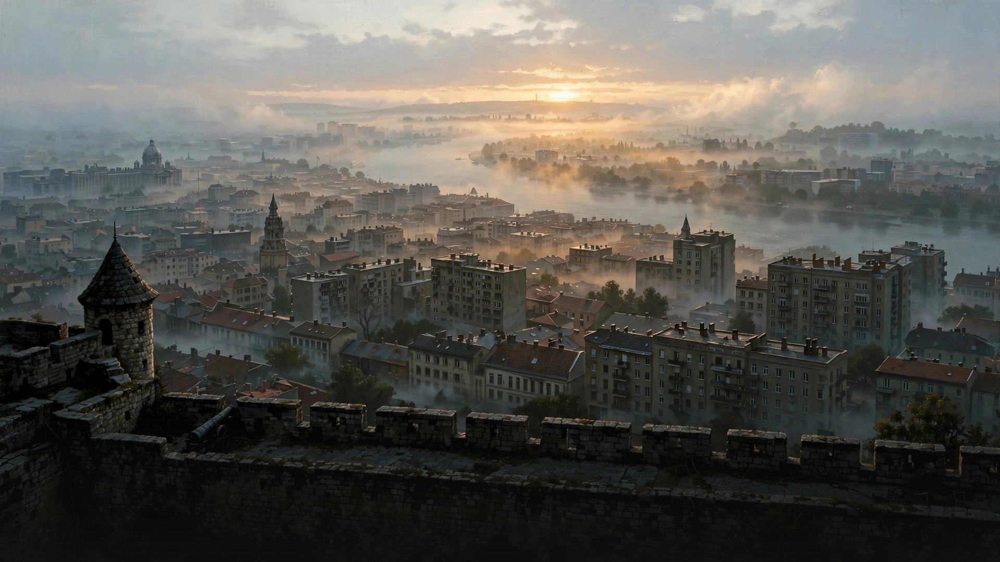
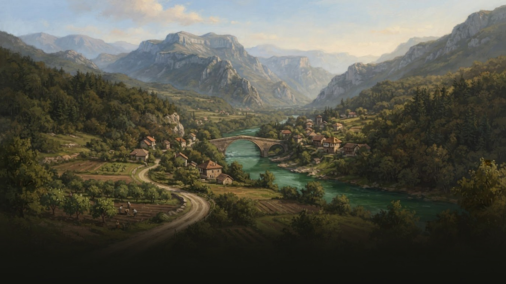
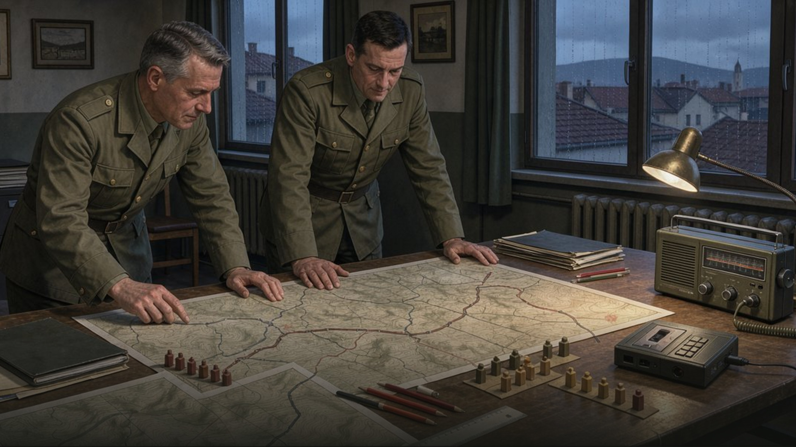

# Загрузочные иллюстрации Reworkl 1.2.1

Три созданные с помощью ИИ иллюстрации для экрана загрузки HOI4.
**Это не исторические фотографии и не скриншоты работающей игры.**

## 1. Белград на рассвете



`gfx/loadingscreens/reworkl_belgrade.dds`

## 2. Динарские горы



`gfx/loadingscreens/reworkl_mountains.dds`

## 3. Штаб, 1989



`gfx/loadingscreens/reworkl_headquarters.dds`

## Как подключены

- Все игровые файлы — **1920×1080, DDS/DXT1, один уровень**, без альфа-канала.
  Каждая текстура занимает 1 036 928 байт, вместе — около 3 МиБ.
- HOI4 читает фоны из `gfx/loadingscreens`. В `descriptor.mod` добавлено
  `replace_path="gfx/loadingscreens"`, чтобы не смешивать их с базовой игрой.
  Внешний `reworkl.mod` при сборке/установке получает тот же параметр.
- Старые PNG-заглушки и `GFX_loading_serbia_*` удалены: объявить спрайт,
  который загрузочный интерфейс не использует, недостаточно.
- Нестандартный `common/loading_tips/Y89_loading_tips.txt` удалён.
  Десять собственных подсказок используют штатные ключи `LOADING_TIP_0`…`9`
  в UTF-8 BOM файлах `localisation/replace/reworkl_loading_l_*.yml`.
  Остальные подсказки установленной игры не изменялись.
- Обычные индикаторы и текст рисует сама игра; поддельной полосы прогресса
  и текста интерфейса внутри картинок нет. Низ изображений затемнён.
- Для запуска мода и сборки ZIP не нужны ImageMagick, Python-медиабиблиотеки
  или генератор изображений: готовые DDS уже входят в комплект.

## Повторное преобразование JPEG в DDS

Для редактирования доступны JPEG-превью. При наличии ImageMagick из корня
репозитория можно повторить преобразование:

```sh
for name in belgrade mountains headquarters; do
  convert "website/assets/loading-$name.jpg" -alpha off \
    -define dds:compression=dxt1 -define dds:mipmaps=0 \
    "gfx/loadingscreens/reworkl_$name.dds"
done
python scripts/validate_mod.py
python scripts/build_mod.py
```

`dds:mipmaps=0` отключает дополнительные mip-уровни; в DDS остаётся один
основной уровень. После замены JPEG его размер должен оставаться 1920×1080.

## Проверка

Автоматически проверяются имена/наличие всех трёх DDS, заголовок, формат,
разрешение, полная длина данных, подключение папки, локализация и упаковка
в ZIP. DDS также декодированы ImageMagick; превью просмотрены визуально.

**Запуск HOI4 здесь не выполнялся.** Чтобы проверить отображение в движке,
нужен полный перезапуск установленной игры с единственным активным Reworkl;
см. [план ручной проверки](TESTING.md#картинки-загрузки).
